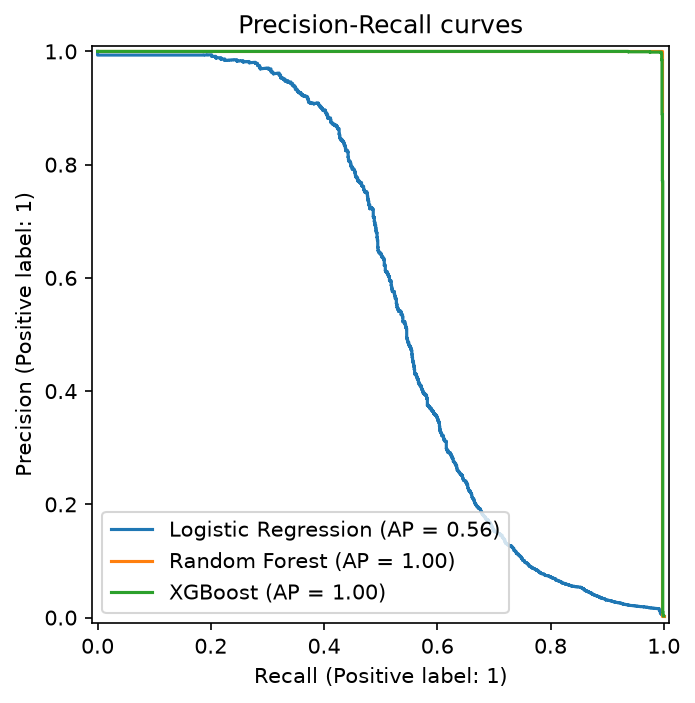
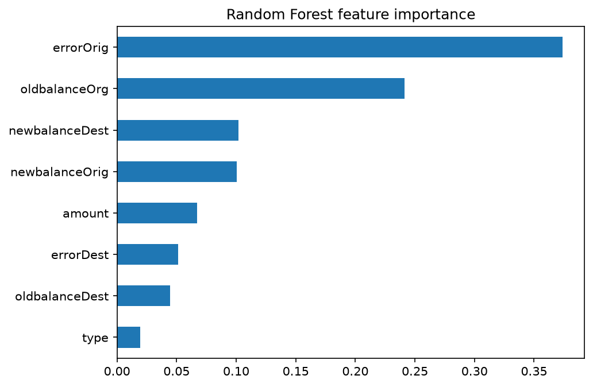
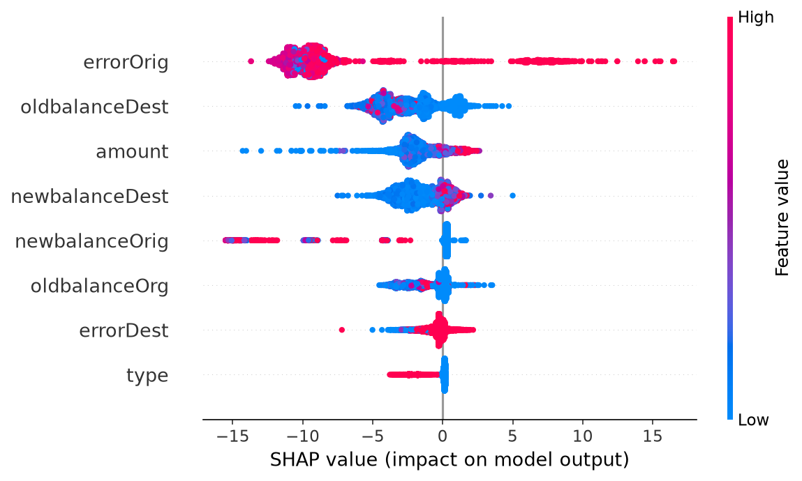

# Mobile Money Fraud Detection (PaySim)

A machine learning project that detects fraudulent mobile money transactions on the PaySim synthetic dataset. It covers exploratory analysis, feature engineering, handling extreme class imbalance, model comparison, interpretability with SHAP, a time-based validation check, and a Streamlit demo app.

**Live demo:** https://paysim-fraud-detect.streamlit.app

## Problem

Fraud is rare (about 0.13% of all transactions), so accuracy is meaningless: a model that predicts "not fraud" every time is 99.87% accurate and catches nothing. The goal is to catch as many frauds as possible while keeping false alarms low, so models are evaluated with precision, recall, F1 and PR-AUC.

## Dataset

- PaySim, a synthetic mobile money simulation based on real transaction logs: about 6.3 million transactions over 30 days (744 hourly steps).
- Source: [Synthetic Financial Datasets For Fraud Detection (Kaggle)](https://www.kaggle.com/datasets/ealaxi/paysim1)
- Credit: Lopez-Rojas, E. A., Elmir, A., Axelsson, S. "PaySim: A financial mobile money simulator for fraud detection." Licensed CC BY-SA 4.0.
- The raw CSV (about 470 MB) is not included in this repository. Download it from Kaggle and place it in a `data/` folder.

## Approach

1. **Exploration:** fraud occurs only in `TRANSFER` and `CASH_OUT` transactions, so the data was filtered to those two types (2.77 million rows).
2. **Feature engineering:**
   - `errorOrig = oldbalanceOrg - amount - newbalanceOrig`
   - `errorDest = oldbalanceDest + amount - newbalanceDest`
   - These capture balance inconsistencies that appear in fraudulent transactions.
3. **Dropped columns:** `nameOrig` and `nameDest` (identifiers that would cause overfitting), `isFlaggedFraud` (rule-based flag, not a real feature) and `step`.
4. **Split:** stratified 80/20 train/test split, done before any resampling.
5. **Imbalance handling:** class weights (`class_weight="balanced"`, `scale_pos_weight`) rather than resampling.
6. **Models:** Logistic Regression, Random Forest, XGBoost.
7. **Evaluation:** confusion matrix, precision, recall, F1, ROC-AUC and PR-AUC.
8. **Interpretation:** feature importance and SHAP.
9. **Robustness checks:** an ablation without the engineered features, and a time-based split.

## Results

Test set: 554,082 transactions, of which 1,643 are fraud.

| Model | PR-AUC | Notes |
|---|---|---|
| Logistic Regression | 0.56 | Recall 0.88 but precision only 0.04 (35,872 false alarms) |
| Random Forest | ~1.00 | Precision 0.998, recall 0.997 (3 false positives, 5 missed frauds) |
| XGBoost | ~1.00 | Comparable to Random Forest |

Additional checks:

- **Ablation:** Random Forest without `errorOrig` and `errorDest` still reaches PR-AUC 0.941, so the raw balance columns carry most of the signal, and the engineered features add further lift.
- **Time-based split:** training on steps 1 to 599 and testing on steps 600 to 744 (1,618 frauds in the test period) gives PR-AUC 1.0 for XGBoost, so the result holds on later data and is not an artifact of the random split.

### Precision-Recall curves



### Feature importance (Random Forest)



### SHAP summary (XGBoost)



## Key findings

- `errorOrig` is the strongest signal. High values push predictions strongly toward fraud.
- Fraudulent transactions typically empty the sender's account (`newbalanceOrig` close to 0) and move the money out, which is the pattern the models learn.
- Logistic Regression underperforms because the fraud pattern is non-linear.

## Limitations

- PaySim is simulated data. Its fraud pattern is consistent across the whole period, which is why scores are near perfect. Real-world fraud changes as fraudsters adapt, so similar performance should not be expected in production.
- SHAP shows what the model relies on, not what causes fraud.
- The decision threshold was left at the default 0.5. In a real system it should be tuned to the business cost of false alarms versus missed fraud.

## Demo app

The Streamlit app takes transaction details (type, amount, sender and receiver balances before and after), computes the engineered features, and returns a fraud probability with an adjustable decision threshold.

Example inputs: a `TRANSFER` of 1,810,000 where the sender goes from 1,810,000 to 0 and the receiver stays at 0 is flagged as fraud with probability near 100%.

## How to run

```bash
git clone https://github.com/fathimathfarha24/paysim-fraud
cd paysim-fraud
python -m venv .venv
.venv\Scripts\activate        # Windows
# source .venv/bin/activate   # macOS/Linux
python -m pip install -r requirements.txt
```

1. Download the dataset from Kaggle and place the CSV in `data/`.
2. Open `paysim-fraud.ipynb` and run all cells to reproduce the analysis and save the model to `models/`.
3. Launch the app:

```bash
python -m streamlit run app.py
```

## Project structure

```
.
├── app.py                  # Streamlit demo
├── paysim-fraud.ipynb      # Full analysis notebook
├── requirements.txt
├── models/
│   └── xgb_fraud.joblib    # Trained XGBoost model
├── images/                 # Plots used in this README
└── data/                   # Dataset (not committed)
```

## Tech stack

Python, pandas, scikit-learn, XGBoost, SHAP, matplotlib, Streamlit.

## Author

Fathimath Farha